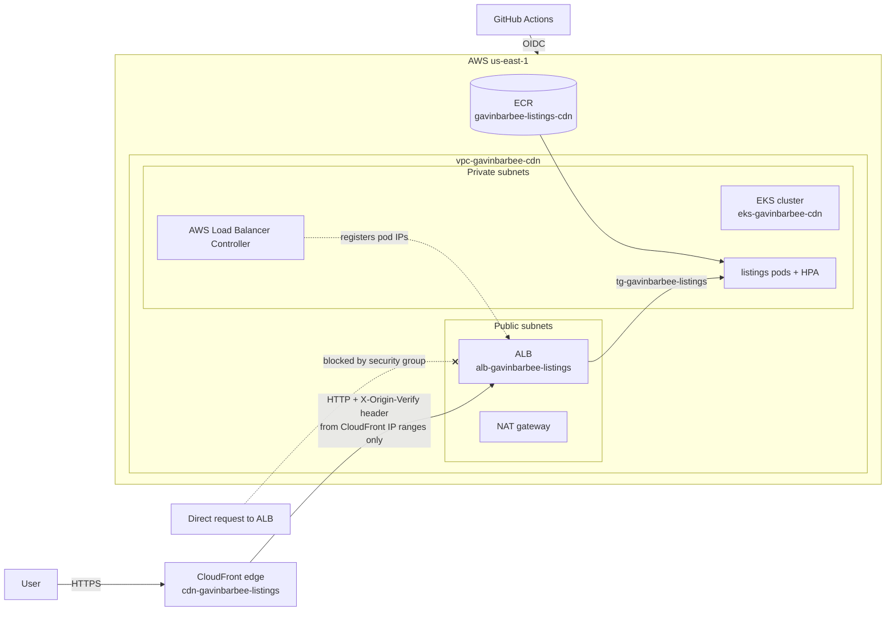

# AWS EKS Behind CloudFront: CDN Caching and Origin Protection

**Status:** 🚧 In progress

## Video Walkthrough

> Loom walkthrough coming soon.

## Project Overview

I put a CloudFront CDN in front of an app running on Amazon EKS, the same pattern high-traffic listing sites use to serve pages fast from edge locations close to users. Terraform builds the whole stack through GitHub Actions: VPC, EKS, an Application Load Balancer, and the CloudFront distribution, behind the same Checkov gate, OIDC federation, and approval-before-apply pipeline as my [EKS platform lab](https://github.com/gavinbarbee/aws-eks-terraform-pipeline).

Caching follows the origin's headers: HTML is cached at the edge for 60 seconds and versioned images for a year. Every deploy invalidates the HTML, so a new release shows up right away while static assets keep serving from cache.

The origin is locked down two ways. The ALB's security group only accepts CloudFront's origin-facing IP ranges, and the ALB only forwards requests carrying a secret header that CloudFront adds. Hitting the ALB directly gets nowhere.

### Skills Demonstrated

- **CDN configuration:** CloudFront distribution with managed cache and security-headers policies, HTTP/2 and HTTP/3, compression, HTTPS redirect, and cache invalidation on deploy
- **Cache design:** origin-driven `Cache-Control` headers with short TTLs for HTML and long, immutable TTLs for static assets, verified with `X-Cache` and `Age` headers
- **Origin protection:** security group limited to the CloudFront managed prefix list, plus a secret header checked by an ALB listener rule
- **Kubernetes load balancing:** AWS Load Balancer Controller with a TargetGroupBinding that registers pod IPs into a Terraform-managed target group
- **IAM for workloads:** EKS Pod Identity granting the controller its AWS permissions without node-level credentials
- **Infrastructure as code and CI/CD:** Terraform through GitHub Actions with OIDC (immutable subject claims), a Checkov gate, and dev environment approval on a saved plan

## Architecture Diagram



## Prerequisites

- Lab 1's bootstrap stack still deployed. It owns the account's GitHub OIDC provider, which this lab looks up instead of creating a second one
- AWS CLI v2 with my `admin` profile (IAM user `gavinbarbee-admin`)
- Terraform 1.10 or later, kubectl, Helm, and the GitHub CLI (`gh`)
- Windows with PowerShell and VS Code

> **Cost note:** The EKS control plane, two t3.medium nodes, a NAT gateway, and an ALB come to roughly $6–8/day by my estimate. CloudFront costs almost nothing at lab traffic. I tear it down the same day I finish.

## Naming Conventions

| Resource | Name |
|---|---|
| GitHub repo | gavinbarbee/aws-eks-cloudfront-cdn |
| State bucket | gavinbarbee-cdn-tfstate-&lt;random suffix&gt; |
| GitHub Actions IAM role | role-gavinbarbee-github-actions-cdn |
| VPC | vpc-gavinbarbee-cdn |
| EKS cluster | eks-gavinbarbee-cdn |
| ECR repository | gavinbarbee-listings-cdn |
| ALB | alb-gavinbarbee-listings |
| ALB security group | sg-gavinbarbee-alb |
| Target group | tg-gavinbarbee-listings |
| CloudFront distribution | cdn-gavinbarbee-listings (comment) |
| Load Balancer Controller IAM role | aws-lbc-gavinbarbee |
| Helm releases | listings, aws-load-balancer-controller, metrics-server |
| GitHub environment | dev |

## Project Steps

### 1. Create the project folder and repo

```powershell
cd $HOME\OneDrive\Desktop
mkdir aws-eks-cloudfront-cdn
cd aws-eks-cloudfront-cdn
git init -b main
gh repo create gavinbarbee/aws-eks-cloudfront-cdn --public `
  --description "EKS behind CloudFront with Terraform and GitHub Actions: CDN caching, invalidation on deploy, and origin protection" `
  --source . --remote origin
```

### 2. Confirm my AWS identity

```powershell
$env:AWS_PROFILE = "admin"
aws sts get-caller-identity
$adminArn = aws sts get-caller-identity --query Arn --output text
```

> 📸 Screenshot: caller identity (account ID blurred)

### 3. Bootstrap the state bucket and pipeline role

My repos use GitHub immutable subject claims, so the role's trust policy needs this repo's numeric ID:

```powershell
$repoId = gh api repos/gavinbarbee/aws-eks-cloudfront-cdn --jq .id
cd bootstrap
terraform init
terraform plan -var "github_repo_id=$repoId" "-out=main.tfplan"
terraform apply main.tfplan
cd ..
```

> 📸 Screenshot: bootstrap apply output
> 📸 Screenshot: IAM role trust relationship showing the repo ID condition

### 4. Store pipeline settings as GitHub variables

```powershell
gh variable set AWS_REGION --body "us-east-1"
gh variable set AWS_ROLE_ARN --body (terraform -chdir=bootstrap output -raw github_actions_role_arn)
gh variable set TF_STATE_BUCKET --body (terraform -chdir=bootstrap output -raw state_bucket)
gh variable set ADMIN_PRINCIPAL_ARN --body $adminArn
gh variable list
```

### 5. Create the dev environment approval gate

In GitHub: **Settings → Environments → New environment → `dev`**. I enabled **Required reviewers** and added myself, left **Prevent self-review** unchecked (I'm the only reviewer), and turned off **Allow administrators to bypass**.

> 📸 Screenshot: dev environment protection rules

### 6. Open a pull request to run the security gate and plan

```powershell
git checkout -b feature/cloudfront-cdn
git status
git add .
git commit -m "feat: EKS behind CloudFront with ALB origin protection"
git push -u origin feature/cloudfront-cdn
gh pr create --fill
```

> 📸 Screenshot: Checkov gate and plan on the PR

#### Checkov decisions

The first run failed 16 checks. I fixed two in code and suppressed the rest with inline `#checkov:skip` comments in each resource, so every exception sits next to the code it covers.

| Check | Decision | Reason |
|---|---|---|
| CKV_AWS_374 | Fixed | Geo restriction set to a US allowlist |
| CKV_AWS_305 | Fixed | Default root object set to `index.html` |
| CKV_AWS_260 | Skipped | False positive: ingress is limited to the CloudFront managed prefix list, not 0.0.0.0/0 |
| CKV2_AWS_20 | Skipped | No custom domain, so no ACM certificate for HTTPS on the origin or a custom viewer certificate; viewers still get HTTPS from CloudFront |
| CKV_AWS_2 | Skipped | No custom domain, so no ACM certificate for HTTPS on the origin or a custom viewer certificate; viewers still get HTTPS from CloudFront |
| CKV_AWS_103 | Skipped | No custom domain, so no ACM certificate for HTTPS on the origin or a custom viewer certificate; viewers still get HTTPS from CloudFront |
| CKV_AWS_378 | Skipped | No custom domain, so no ACM certificate for HTTPS on the origin or a custom viewer certificate; viewers still get HTTPS from CloudFront |
| CKV_AWS_174 | Skipped | No custom domain, so no ACM certificate for HTTPS on the origin or a custom viewer certificate; viewers still get HTTPS from CloudFront |
| CKV2_AWS_42 | Skipped | No custom domain, so no ACM certificate for HTTPS on the origin or a custom viewer certificate; viewers still get HTTPS from CloudFront |
| CKV2_AWS_28 | Skipped | WAF adds monthly cost; origin is protected by the CloudFront prefix list and a secret header instead |
| CKV_AWS_68 | Skipped | WAF adds monthly cost; origin is protected by the CloudFront prefix list and a secret header instead |
| CKV2_AWS_47 | Skipped | WAF adds monthly cost; origin is protected by the CloudFront prefix list and a secret header instead |
| CKV_AWS_91 | Skipped | Access logging needs extra S3 log buckets, out of scope for this lab |
| CKV_AWS_86 | Skipped | Access logging needs extra S3 log buckets, out of scope for this lab |
| CKV_AWS_150 | Skipped | Deletion protection would block same-day lab teardown |
| CKV_AWS_310 | Skipped | Origin failover needs a second origin, out of scope for a single-region lab |

### 7. Merge and approve the apply

```powershell
gh pr merge --squash --delete-branch
git checkout main
git pull
```

I approved the `dev` deployment in the Actions tab. EKS takes about 15 minutes, and CloudFront takes a few more to deploy to its edge locations.

> 📸 Screenshot: approval with review comment
> 📸 Screenshot: successful apply

### 8. Connect kubectl

```powershell
aws eks update-kubeconfig --region us-east-1 --name eks-gavinbarbee-cdn
kubectl get nodes
```

> 📸 Screenshot: two Ready nodes

### 9. Deploy the app

```powershell
gh workflow run deploy.yml
gh run watch
```

The workflow builds and pushes the image, installs metrics-server and the AWS Load Balancer Controller, deploys the chart with a TargetGroupBinding, and invalidates the CloudFront HTML cache.

```powershell
kubectl get pods,svc,targetgroupbinding
$cf = terraform -chdir=terraform output -raw cloudfront_domain
Start-Process "https://$cf"
```

> 📸 Screenshot: deploy workflow run
> 📸 Screenshot: target group with healthy pod IPs (EC2 → Target groups)
> 📸 Screenshot: listings page on the CloudFront domain

### 10. Prove the cache is working

The first request for an asset is a miss, and the next one is served from the edge:

```powershell
curl.exe -sI "https://$cf/assets/house.svg"
curl.exe -sI "https://$cf/assets/house.svg"
```

The second response shows `X-Cache: Hit from cloudfront`, an `Age` header, and `Cache-Control: public, max-age=31536000, immutable`. The HTML shows `max-age=60`:

```powershell
curl.exe -sI "https://$cf/"
```

> 📸 Screenshot: Miss then Hit on the asset
> 📸 Screenshot: HTML Cache-Control header

### 11. Prove the origin is protected

```powershell
$alb = terraform -chdir=terraform output -raw alb_dns_name
curl.exe -sI --max-time 10 "http://$alb/"
```

The request times out, because the ALB security group only allows CloudFront's IP ranges. Even a request from inside those ranges without the secret header would get a 403 from the listener's default action.

> 📸 Screenshot: direct ALB request timing out
> 📸 Screenshot: ALB security group inbound rule referencing the CloudFront prefix list

### 12. Ship a new release and invalidate

I changed `Release v1` to `Release v2` in `app/index.html` and pushed through a PR. The deploy workflow ran on merge and created an invalidation for the HTML, so v2 appeared right away instead of waiting out the 60-second TTL:

```powershell
git checkout -b feature/release-v2
git add app/index.html
git commit -m "feat: release v2"
git push -u origin feature/release-v2
gh pr create --fill
gh pr merge --squash --delete-branch
git checkout main
git pull
gh run watch
```

> 📸 Screenshot: invalidation in CloudFront (Invalidations tab)
> 📸 Screenshot: page showing Release v2

## Verification Checklist

- [ ] Bootstrap reused the existing GitHub OIDC provider and the role trusts this repo by ID
- [ ] Checkov passed and the apply waited for `dev` approval
- [ ] Target group shows healthy pod IPs registered by the controller
- [ ] Site loads over HTTPS on the CloudFront domain
- [ ] Asset returns Miss, then Hit, with a one-year `Cache-Control`
- [ ] HTML returns `max-age=60`
- [ ] Direct request to the ALB fails
- [ ] Release v2 appeared immediately after the deploy's invalidation

## Troubleshooting

| Issue | Cause | Fix |
|---|---|---|
| | | |

## Cleanup

Remove the app before the controller, so the controller can deregister targets and clear the TargetGroupBinding's finalizer:

```powershell
$env:AWS_PROFILE = "admin"
helm uninstall listings
kubectl get targetgroupbinding
helm uninstall aws-load-balancer-controller --namespace kube-system
helm uninstall metrics-server --namespace kube-system

terraform -chdir=terraform init -backend-config="bucket=$(terraform -chdir=bootstrap output -raw state_bucket)"
terraform -chdir=terraform plan -destroy -var "admin_principal_arn=$adminArn" "-out=destroy.tfplan"
terraform -chdir=terraform apply destroy.tfplan
```

CloudFront has to disable the distribution before deleting it, so the destroy takes several extra minutes. I kept the PC awake until it finished.

When the lab series is finished, I remove this lab's bootstrap stack:

```powershell
terraform -chdir=bootstrap plan -destroy -var "github_repo_id=$repoId" "-out=destroy.tfplan"
terraform -chdir=bootstrap apply destroy.tfplan
```

## Key Takeaways

_Written after the build._

---

*Built by Gavin Barbee · Time to complete: to be updated after the build*
